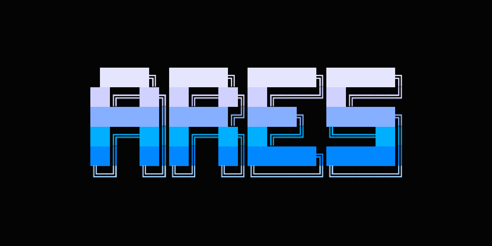

# ⚡ A.R.E.S. (Adaptive Reasoning & Execution System)

<div align="center">



<br/><br/>


<br/>

<h3><b>The Next-Generation Private, Voice-Enabled Executive Terminal AI Companion</b></h3>
<i>Engineered for zero-leak local computation, low-latency neural speech synthesis, and autonomous operating system execution.</i>

<p>
  <a href="docs/assets/ares_thumbnail_dark.jpg"><b>[Dark Theme Thumbnail]</b></a> &nbsp;•&nbsp; 
  <a href="docs/assets/ares_thumbnail_light.jpg"><b>[Light Theme Thumbnail]</b></a>
</p>

</div>

---

## 🚀 Why A.R.E.S. vs Legacy Voice Assistants?

Most open-source JARVIS projects rely on brittle, 1990s-era `if "keyword" in query:` matching and robotic `pyttsx3` synthesizers. 

**A.R.E.S.** replaces obsolete keyword scripts with a modern **Cognitive LLM Brain** and **Neural Speech Synthesis**:

| Feature | Legacy Rule-Based Assistants | ⚡ A.R.E.S. (Adaptive Reasoning & Execution) |
| :--- | :--- | :--- |
| **Cognitive Intelligence** | ❌ Rigid `if/else` keyword regex matching | **True Cognitive LLM** (Ollama: Llama 3.2, DeepSeek, Qwen) |
| **Speech Quality** | ❌ Robotic, monotonous `pyttsx3` (SAPI5/eSpeak) | **Ultra-realistic Neural Voice** (`Edge-TTS` + macOS `afplay`) |
| **Operating System Control** | ⚠️ Hardcoded system scripts prone to crashes | **Action Dispatch Engine** (Apps, Volume, Media, Screenshots) |
| **Hardware Telemetry** | ⚠️ Basic prints | **Live Host Telemetry** (CPU load, RAM MB, Battery, Disk free) |
| **Privacy & Sovereignty** | ❌ Unencrypted API endpoints & hardcoded tokens | **100% Air-Gapped Sandbox** (Zero telemetry, Zero data leak) |
| **Terminal Experience** | ❌ Plain terminal text | **Cyberpunk Sci-Fi HUD** (`Rich` streaming tables & panels) |

---

## 🛰️ Architecture & System Blueprint

```
                  ┌──────────────────────────────────────────────┐
                  │                 USER QUERY                   │
                  │         (CLI Terminal / Voice Audio)         │
                  └──────────────────────┬───────────────────────┘
                                         │
                                         ▼
                  ┌──────────────────────────────────────────────┐
                  │            A.R.E.S. ORCHESTRATOR             │
                  │   - Intent Classification & Cognitive Parse  │
                  │   - Sliding Window Context Memory            │
                  │   - Action Safeguards & Sandbox Dispatcher   │
                  └──────────────┬────────────────┬──────────────┘
                                 │                │
            Air-Gapped Pipeline  │                │ Cloud Fallback (Opt-in)
                                 ▼                ▼
                     ┌──────────────────┐  ┌──────────────────┐
                     │  OLLAMA / LOCAL  │  │  SECURE API HUB  │
                     │ (Zero Telemetry) │  │  (Encrypted/Fast)│
                     └─────────┬────────┘  └────────┬─────────┘
                               │                    │
                               └──────────┬─────────┘
                                          │
                                          ▼
                ┌────────────────────────────────────────────────┐
                │             DUAL OUTPUT ENGINE                 │
                │                                                │
                │  [Rich Terminal HUD]       [Edge-TTS Stream]   │
                │   - Live Markdown Stream    - Sentence Queue   │
                │   - Cyberpunk Badges        - macOS afplay     │
                │   - Action Telemetry Box    - British / Neural │
                └────────────────────────────────────────────────┘
```

---

## 🛠️ Key Capabilities & Actions

- 🎙️ **Hyper-Realistic Neural Speech**: Low-latency voice streaming using Microsoft Edge Neural models (`en-GB-RyanNeural`, `en-US-ChristopherNeural`, `bn-BD-PradeepNeural`).
- 📸 **Retina Screenshot Capture**: Instant desktop capture saved directly to macOS Desktop.
- 🌦️ **Zero-Key Live Weather**: Real-time atmospheric conditions and temperatures via lightweight endpoints.
- 🎵 **Native Media & Music Control**: Automated play, pause, and track skip for Spotify and Apple Music via AppleScript.
- 🖥️ **System Telemetry**: Continuous monitoring of battery health, CPU load, memory utilization, and disk availability.
- 🌐 **Web Intelligence & Application Control**: Autonomous Google searching and desktop app launching.

---

## ⚡ Quickstart

### 1. Clone the Repository
```bash
git clone https://github.com/khalidabdullahh/ares.git
cd ares
```

### 2. Install Dependencies
```bash
python3 -m venv .venv
source .venv/bin/activate
pip install -r requirements.txt
```

### 3. Launch Local Ollama Brain
```bash
ollama run llama3.2
```

---

## 🔒 Confidentiality & Security Notice

> [!NOTE]
> This public repository contains the architectural specifications, public interfaces, and concept mechanisms of A.R.E.S.
> Proprietary internal weights, custom execution harnesses, internal agent prompts, and operational core modules are isolated and maintained under private deployment protocols.

For detailed architecture analysis, consult the [Architecture Document](docs/ARCHITECTURE.md) and [Security Manifesto](docs/SECURITY.md).

---

## 🏷️ Topics & Discoverability
`jarvis` • `jarvis-ai` • `ai-assistant` • `voice-assistant` • `private-ai` • `ollama` • `edge-tts` • `rich-terminal` • `personal-assistant` • `speech-recognition` • `ai-agent` • `terminal-ui` • `python` • `python3` • `deepseek` • `llama3` • `chatgpt` • `mac-assistant`

---

## 👨‍💻 Creator & Lead Architect

<div align="center">


### **Khalid Abdullah**
<i>Computer Science Student & Systems Builder</i><br/>
📍 **Bangladesh** 🇧🇩

<p>
  <a href="https://github.com/khalidabdullahh"></a>
  <a href="https://khalidslab.pages.dev"></a>
  <a href="https://twitter.com/voiceoffkhalid"></a>
</p>

> *"Computer Science student with an insatiable curiosity for Technology, Mathematics, and Problem Solving — learning, building, and exploring where ideas meet code."*

<p>
  💬 Join the official launch discussion: <a href="https://github.com/khalidabdullahh/ares/discussions/1"><b>[A.R.E.S. Launch Announcement]</b></a>
</p>

</div>

---

## 📄 License & Attribution

Architected and developed by [Khalid Abdullah](https://github.com/khalidabdullahh).  
Licensed under the [MIT License](LICENSE).
