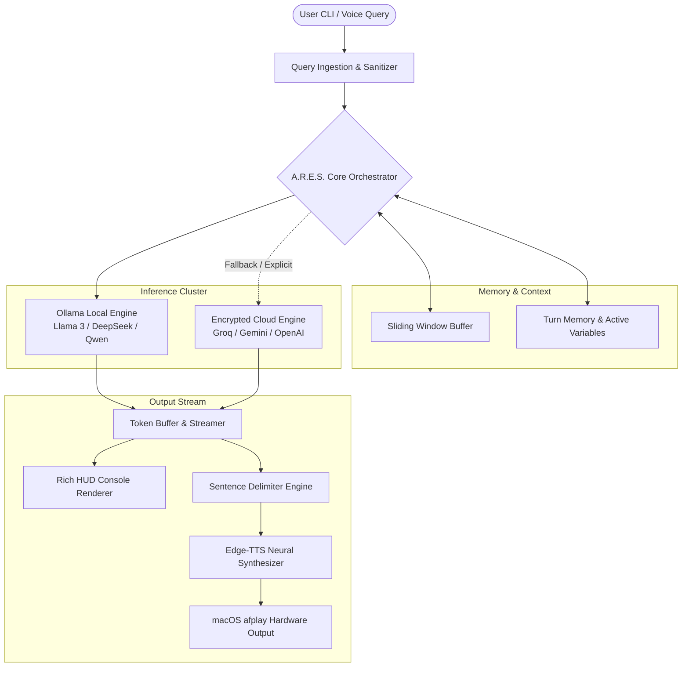

# A.R.E.S. System Architecture & Engineering Specifications

This document outlines the architectural blueprints, subsystem interaction contracts, and design principles powering **A.R.E.S.** (Autonomous & Responsive Executive System).

---

## 1. High-Level Subsystem Breakdown



---

## 2. Low-Latency Speech Synthesis Mechanics

A critical challenge with conventional voice AI systems is **Time-to-First-Audio (TTFA)**. If the audio pipeline waits for the entire LLM generation to complete before synthesizing speech, the user experiences 3-10 seconds of dead air.

A.R.E.S. addresses this through a **Pipelined Sentence Delimiter Buffer**:

1. Tokens stream in real time from the active inference model.
2. The `SentenceTokenizer` monitors the live token stream for punctuation delimiters (`.`, `?`, `!`, `\n`).
3. As soon as sentence $S_1$ is complete, it is dispatched asynchronously to the `Edge-TTS` engine in a non-blocking coroutine.
4. While $S_1$ is synthesized and played via `/usr/bin/afplay`, the LLM simultaneously streams $S_2$ and $S_3$.
5. The queue maintains seamless acoustic continuity without stuttering.

---

## 3. Privacy & Air-Gapped Operation

```
+-------------------------------------------------------------+
|                     PHYSICAL HOST MACHINE                   |
|                                                             |
|   +-----------------------+     +-----------------------+   |
|   |   A.R.E.S. CLI HUD    | <-> |    Local Ollama API   |   |
|   |    (Local Process)    |     |    (127.0.0.1:11434)  |   |
|   +-----------+-----------+     +-----------+-----------+   |
|               |                             |               |
|               v                             v               |
|   +-----------------------+     +-----------------------+   |
|   |  Memory Buffer (RAM)  |     |  Local Model Weights  |   |
|   +-----------------------+     +-----------------------+   |
+-------------------------------------------------------------+
            \                                   /
             \===== NO OUTBOUND TRAFFIC =======/
```

- When configured in `ollama` mode, all compute runs locally on host hardware (Apple Silicon unified memory or dedicated GPU).
- Prompt tokens, system outputs, and conversation contexts are confined strictly to RAM and ephemeral session logs.
